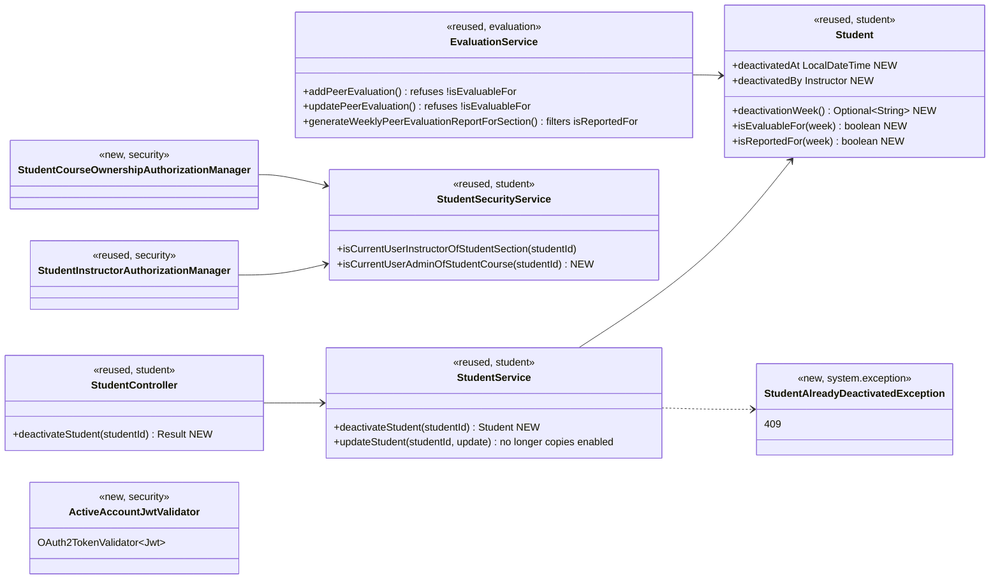
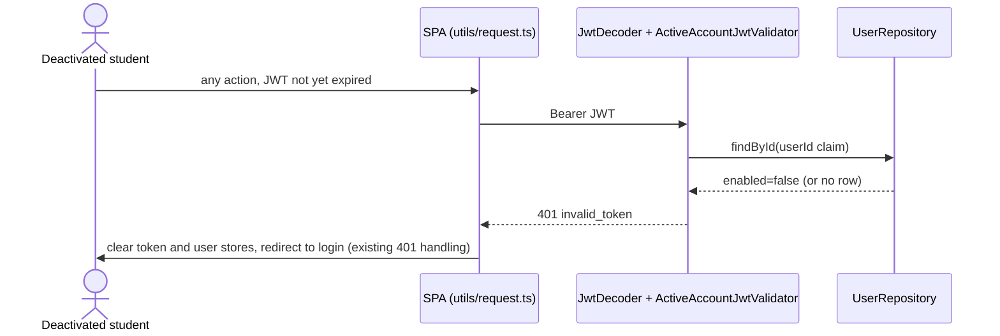
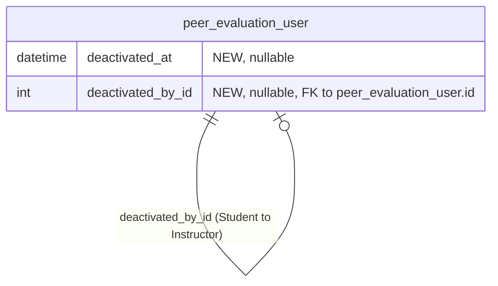

# Student (STU) Design

> Realizes: UC-STU-deactivate-student
> Depends on: FR-SEC-active-account, BR-student-lifecycle, BR-evaluation-active-evaluatee, BR-evaluation-submission-window, BR-evaluation-editable-until-close, BR-submission-owed, BR-section-scoped-access, BR-role-based-access
> See: [use cases](../requirements/use-cases.md#student), [SRS security requirements](../requirements/software-requirements-specification.md#security-and-authorization-requirements), [architectural-design.md](architectural-design.md#building-block-view) (foundation component view, Crosscutting Concepts)
> Designed against `main` at `59f0267` (2026-11-06).

## Overview

The STU area manages a student's account inside a course section: invitation, finding and viewing her, and her lifecycle (deactivate, reactivate, delete). It lives in the foundation's `student` feature slice in the REST API container. This doc covers only what has been designed through `/design`; the as-built STU use cases are mapped in [`../traceability.md`](../traceability.md).

Before this design, deactivation was the `enabled` switch on the edit-student form, saved through the generic `PUT /students/{id}`. That path showed no warning or confirmation (steps 4–5). It shut out a course admin who isn't an instructor of the course section. It recorded nothing about when or who. It cut off only the student's next *login*: her current 2-hour JWT kept working, against FR-SEC-active-account. This design replaces the switch with a dedicated action, and makes every bearer request recheck the account's status.

## Components & classes



**Backend** (`backend/src/main/java/team/projectpulse/`):
- `student/`: `StudentController`, `StudentService`, `Student`, `StudentSecurityService`, `converter/StudentToStudentDtoConverter`, and `dto/StudentDto`. The DTO gains a nullable `deactivatedAt`, for the 3a display, and a nullable `deactivationWeek`, for the evaluation form.
- `security/`: `ActiveAccountJwtValidator` (new), added to `SecurityConfiguration.jwtDecoder()` alongside the default validators. `authorizationmanagers/StudentCourseOwnershipAuthorizationManager` (new). The new route rule in `SecurityConfiguration`.
- `evaluation/EvaluationService`.
- `system/exception/StudentAlreadyDeactivatedException` (new) and its `ExceptionHandlerAdvice` handler.
- `resources/db/migration/V7__student_deactivation_audit.sql` (new).

**Frontend** (`frontend/src/`):
- `apis/student/index.ts` gains `deactivateStudent`, and `types` gains the two DTO fields.
- `pages/students/EditStudentForm.vue` loses the Status switch:
  - For an enabled student it shows a **Deactivate** button, which opens an `ElMessageBox` confirmation.
  - For a deactivated student it shows "Deactivated · <date>" ("date unknown" when `deactivatedAt` is null) in place of the button (3a).
  - The confirmation states the use case's consequences. It says her account and her work are kept, and it does **not** offer or imply a reactivation action, because none exists until UC-STU-reactivate-student is built.
  - The form is reached only from the instructor-only `Students.vue`.
- `pages/evaluations/SubmitTeamsEvaluations.vue` omits a deactivated teammate when her `deactivationWeek` is null or earlier than the week being evaluated. This only spares the student a refusal; the server enforces the rule.

## Sequence

### UC-STU-deactivate-student: main success scenario

```mermaid
sequenceDiagram
    actor I as Instructor / course admin
    participant SPA as EditStudentForm.vue
    participant SEC as security filter chain
    participant C as StudentController
    participant S as StudentService
    participant R as StudentRepository
    I->>SPA: open the student's details (step 2, UC-STU-view-student)
    I->>SPA: Deactivate (step 3)
    SPA->>I: consequences + confirmation (step 4)
    alt cancels (5a)
        SPA->>I: no request; details stay open
    else confirms (step 5)
        SPA->>SEC: PUT /students/{id}/deactivate
        SEC->>SEC: ActiveAccountJwtValidator; anyOf(StudentInstructor, StudentCourseOwnership) [3b → 403]
        SEC->>C: deactivateStudent(id)
        C->>S: deactivateStudent(id)
        S->>R: findById [not found → 404]
        S->>S: already disabled? [3a → 409]
        S->>S: enabled=false, deactivatedAt=LocalDateTime.now(clock), deactivatedBy=caller
        S->>R: save
        C-->>SPA: Result(StudentDto)
        SPA->>I: "student deactivated"; refresh the list (step 6)
    end
```

### UC-STU-deactivate-student 6a: the student is logged in



## API contract

| Endpoint or job | Caller (who may) | Request | Success | Errors, by extension |
|---|---|---|---|---|
| `PUT /students/{studentId}/deactivate` (new) | An instructor assigned to the student's course section, or the course admin of her course: `AuthorizationManagers.anyOf(studentInstructorAuthorizationManager, studentCourseOwnershipAuthorizationManager)` | path `studentId`; no body | 200 `Result` with the updated `StudentDto` (`enabled=false`, `deactivatedAt`, `deactivationWeek`) | 3b → 403 · unknown student → 404 · 3a → 409 |
| `PUT /students/{studentId}` (changed) | unchanged | unchanged; `enabled` in the body is now ignored for every caller | unchanged | unchanged |
| Every bearer-authenticated request (changed) | any JWT holder | — | unchanged | 6a → 401 `invalid_token` when the token's account is disabled or no longer exists |
| `POST /evaluations`, `PUT /evaluations/{evaluationId}` (changed) | unchanged | unchanged | unchanged | 400 `PeerEvaluationIllegalArgumentException` naming the condition when the evaluatee is not `isEvaluableFor` the evaluation's week (BR-evaluation-active-evaluatee) |
| `GET /evaluations/sections/{sectionId}/week/{week}` (changed) | unchanged | unchanged | a deactivated student is listed only when `isReportedFor(week)` | unchanged |

## Key decisions

- **A dedicated action replaces the switch.** The generic update path skips the warning and the confirmation, applies the wrong authorization, and records nothing, so `PUT .../deactivate` takes over and `updateStudent` stops copying `enabled`. The URL leaves room for a symmetric `.../reactivate`. *Rejected:* keeping the switch beside the action, which leaves two paths of which only one is checked. *Rejected:* a `PATCH /students/{id}` with `{enabled:false}`, which is the same generic path under another name. *Cost:* no reactivation path until UC-STU-reactivate-student is built (recorded as an open issue on it).
- **Authorization composes two managers.** The rule is `anyOf(StudentInstructorAuthorizationManager, StudentCourseOwnershipAuthorizationManager)`, the composition UC-NOT-remind-non-submitters already uses for "instructor of the course section, or course admin of its course". `StudentCourseOwnershipAuthorizationManager` reads `studentId`, checks `student.section.course.courseAdmin` against the JWT's `userId`, and fails closed on an unknown id, like `StudentSecurityService`'s other checks. *Rejected:* `UserOwnershipAuthorizationManager`, which admits the student herself and refuses a course admin who isn't an instructor of the course section. *Rejected:* the service's old `ROLE_instructor` test, which admits any instructor in any course.
- **Account status is rechecked on every bearer request** (FR-SEC-active-account). It is an `OAuth2TokenValidator<Jwt>` on the `JwtDecoder`, so a disabled account fails token validation and gets the standard 401 `invalid_token` that the SPA already turns into a redirect to login. It costs one primary-key read per request, with no cache, since a cache would reopen the window it closes. It also cuts off a deactivated instructor (BR-instructor-lifecycle). *Rejected:* a token-version claim or a revocation list, which is heavier and is the general fix for TD-jwt-revocation. *Rejected:* letting the token run out its 2 hours, which breaks the FR.
- **The evaluation cutoff is two predicates over one derived week.** The derived week is `Student.deactivationWeek()`, which is `WeekKeys.of(deactivatedAt.toLocalDate())`, or empty when nothing is recorded. Weeks compare on `WeekKeys.monday()` dates, never as strings.
  - `isEvaluableFor(week)` is true when the student is enabled, or when her cutoff is known and `week` is on or before it. It is false for a legacy row (fail closed).
  - `isReportedFor(week)` is true when the student is enabled, when her cutoff is unknown, or when `week` is on or before it. A legacy row stays in the report for every week, because dropping her would erase the team's record that keeping her on the team exists to preserve.

  *Rejected:* one `wasActiveIn(week)`, which can't express "refuse new evaluations, but keep reporting". *Rejected:* restating the comparison in each `EvaluationService` method.
- **The deactivation time is calendar time.** It is `LocalDateTime.now(clock)` from the injected `Clock`, per Crosscutting Concepts → Time, because "the week she was deactivated" is a calendar question and the `dev` fixed clock must line up with the seed weeks. *Rejected:* `Instant.now()`.
- **`deactivatedBy` is a `@ManyToOne Instructor`.** A course admin is an `Instructor` (`Course.courseAdmin`), so one type covers both actors, and more than one person may hold that authority over her course section, which is why it is recorded. *Rejected:* JPA `@LastModifiedBy`, which is overwritten by any later edit.
- **She stays on her team.** `Student.team` is untouched, so her history stays attached and the BR-evaluation-active-evaluatee window has a team to apply to. *Rejected:* removing her from the team on deactivation.
- **Permitted is not owed.** Teammates *may* evaluate her up to her cutoff, but BR-submission-owed still counts only active teammates, so reminders and the missing-submissions lists don't ask for it. This is accepted rather than changing BR-submission-owed.

## Data model



`V7__student_deactivation_audit.sql` adds both columns. The users share one table (single-table inheritance on `dtype`), so the columns sit on `peer_evaluation_user`, but only `Student` maps them. There is no backfill: a student disabled before V7 keeps `deactivated_at = NULL`, which the predicates above treat as an unknown cutoff. What reactivation does to these columns is open on UC-STU-reactivate-student. The shared model is the SRS's [Business Domain Model](../requirements/software-requirements-specification.md#business-domain-model).

## Reuse & cross-cutting

- **Reused:**
  - The two-layer authorization: URL rules plus `AuthorizationManager`s, with `AuthorizationManagers.anyOf`.
  - `StudentSecurityService`'s fail-closed lookups.
  - The SPA's single 401 handler in `utils/request.ts`.
  - `WeekKeys` for every week computation.
  - The injected `Clock`.
  - `PeerEvaluationIllegalArgumentException` for refusals that name the unmet condition (as BR-team-assignment-required does).
  - `SubmissionStatusService`, which already excludes disabled students from BR-submission-owed.
- **New cross-cutting behavior:** the per-request account-status check, owned by `security`. Recorded in [architectural-design.md](architectural-design.md#crosscutting-concepts) (Security).

## Tests

| Use case, flow | Level (unit / integration) | Asserts |
|---|---|---|
| Deactivate, main: instructor of the course section | integration (`StudentIntegrationTest`) | 200; `enabled=false`; `deactivatedAt` is the dev clock's time; `deactivatedBy` is the caller; the team is unchanged; her WARs and peer evaluations are still present |
| Deactivate, main: course admin not assigned to the course section | integration | 200 (BR-student-lifecycle) |
| Deactivate, main | unit (`StudentServiceTest`) | sets `enabled`, `deactivatedAt`, and `deactivatedBy` from the `Clock` and `UserUtils` |
| Deactivate, 3a: already deactivated | unit and integration | 409; all three fields unchanged |
| Deactivate, 3b: instructor of another course section; the student herself | integration | 403 |
| Deactivate, unknown student | unit | `ObjectNotFoundException` |
| Deactivate, 6a: logged in when deactivated | integration | a JWT issued before the deactivation gets 401 on a protected route; logging in with her password then gets 401 |
| Generic update ignores `enabled` | integration | an instructor's `PUT /students/{id}` with `enabled=false` leaves her enabled |
| BR-evaluation-active-evaluatee: submit | unit (`EvaluationServiceTest`) | evaluating a deactivated teammate is allowed for a week on or before her deactivation week and refused with 400 after it |
| BR-evaluation-active-evaluatee: edit | unit | editing an evaluation of her is refused after her deactivation week |
| BR-evaluation-active-evaluatee: section report | unit | a deactivated student is listed for weeks on or before her deactivation week and omitted after it |
| `isEvaluableFor` / `isReportedFor` | unit | always true when enabled; true on her deactivation week; false after it; correct across an ISO year boundary (`2026-W53` / `2027-W01`) |
| Legacy row: submit and edit | unit (`EvaluationServiceTest`) | a disabled student with `deactivatedAt = null` can't be evaluated for any week (400) |
| Legacy row: section report | unit | a disabled student with `deactivatedAt = null` is listed for every week |
| Legacy row: DTO | unit (converter) | `enabled=false`, `deactivatedAt = null`, `deactivationWeek = null` |
| Deactivate, 5a: cancel | **manual, UI-only** | dismissing the confirmation sends no request; the student stays enabled; the details stay open |
| Deactivate, 3a: display | **manual, UI-only** | a deactivated student's details show "Deactivated" and her date ("date unknown" for a legacy row) in place of the button |

5a and the 3a display are UI-only. These pages have no frontend automated tests, so both are checked by hand, and the build pull request carries a screenshot of the confirmation dialog. The server side of 3a is the 409 row.

## Open questions / risks

- **Reactivation** has no path in the application until UC-STU-reactivate-student is built, and its effect on `deactivated_at` and `deactivated_by` is undecided. Both are recorded as open issues on that use case.
- **Per-request lookup cost:** one primary-key read per API call. It is negligible at the current scale. Revisit together with TD-jwt-revocation if the load profile changes.
